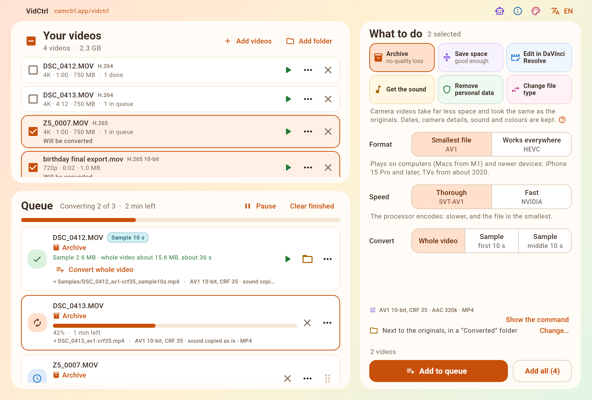
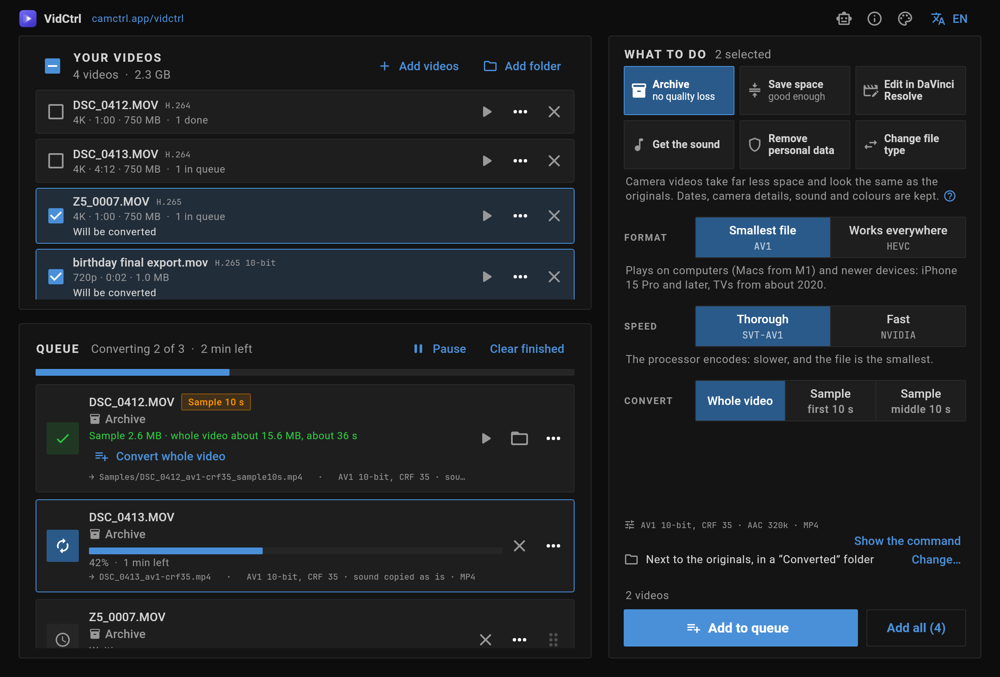

# VidCtrl

A desktop app that converts batches of videos for a few everyday goals, built
for people who do not want to learn what a codec is. It is a friendly front end
for [FFmpeg](https://ffmpeg.org/).

Drop videos in, pick what you want, press **Add to queue**. Converting starts
by itself.

Website: [camctrl.app/vidctrl](https://camctrl.app/vidctrl)

## Download

**[Download the latest version](../../releases/latest)** for Linux, Windows
or macOS. FFmpeg is inside, so there is nothing else to install.

On that page, under **Assets**, take the file for your computer:

| Your computer | The file | Then |
|---|---|---|
| Linux (x64) | the one ending in `-linux-x64.tar.gz` | Unpack it and run `vidctrl` in the folder |
| Windows (x64) | the one ending in `-windows-x64.zip` | Unpack it and run `vidctrl.exe` |
| macOS (Apple Silicon and Intel) | the one ending in `-macos.dmg` | Open it and drag VidCtrl to Applications |

Windows and macOS may refuse to open it the first time; the page says how to
open it anyway.



It comes in two looks. The one above is the one it starts with; this is the
other:



## What it does today

- **Archive** (*no quality loss*). Turns camera videos into a master copy for
  keeping: a fraction of the size, looking the same as the original. One
  quality, the highest; the defaults need no thought. That quality was
  measured, not guessed ([how](#how-the-archive-quality-was-measured)): the
  smallest file that still looks the same. The "?" at the end of its
  explanation opens the short version: the two measures, the levels they must
  reach, and the check before every release. Shooting dates, place, timecode
  and the camera's make and model are kept. Two choices, each saying what it
  trades away:
  - *Format:* *Smallest file* (AV1, the default) or *Works everywhere*
    (HEVC, a larger file that also plays on older iPhones, Macs and TVs).
    Without AV1 in the installed FFmpeg, HEVC is used.
  - *Speed:* *Thorough* (the processor) or *Fast* (the graphics card: much
    quicker, a larger file; offered only when a working one is found).

  Sound is made compact too: the lossless sound of an editor export (FLAC,
  PCM) becomes AAC at 320 kbit/s, which is a small part of a high-quality
  video. Sound that is already AAC is kept untouched.
- **Edit in DaVinci Resolve (Linux).** Makes camera and screen recordings open
  with both picture and sound in Resolve on Linux, for Resolve Studio and for
  the free edition.
- **Save space** (*good enough*). For recordings of video calls and other
  videos kept just in case: the smallest file that is still decent to watch.
  AV1 at most 1080p and 30 frames a second, with sound for speech (AAC at 96
  kbit/s). Set on the hardest footage measured (grass, leaves and smoke from a
  4K camera), it keeps VMAF above 91: fine detail softens a little, the rest
  stays clear. Camera videos come out 8 to 20 times smaller; a video call
  recording, which its app has already squeezed, only about a tenth smaller.
  HDR footage is adjusted to look right on ordinary screens.
- **Get the sound.** Saves the sound track as its own file, untouched by
  default, or as MP3, M4A, WAV or FLAC.
- **Remove personal data.** Strips place, date, camera and author
  information before sharing. Quick (picture and sound copied untouched) or
  thorough (rebuilt from scratch).
- **Change file type.** Moves a video into MP4, MKV or MOV in seconds, without
  re-encoding the picture.

It does the least work that reaches the goal. A file that is already fine is
left alone; a file that only needs its sound converted is done in seconds with
the picture copied untouched; only what must be re-encoded is re-encoded.

### How the archive quality was measured

A master copy is kept instead of the original, so it has to look the same,
and it is made to save space, so it should be no larger than that needs.
Getting both right was one of the main aims of the app. Each way the archive
can encode was set to the smallest file that still looks the same
as the original:

- **The measure:** XPSNR (FFmpeg's `xpsnr` filter), a comparison of the
  copy with the original that weighs each difference by how visible it is.
  42 dB or more is the level reported as visually lossless: no difference
  the eye can see.
- **The footage:** 10-second 4K pieces of different kinds: handheld video
  from a Nikon camera, the hardest to compress; a phone video of a moving
  car; a photo slideshow.
- **The encoders:** every one the goal uses: AV1 and HEVC on the processor
  (SVT-AV1, x265), on an NVIDIA graphics card (NVENC) and HEVC on a Mac's
  Apple chip (VideoToolbox).
- **The setting:** for each encoder, the quality number that gives the
  smallest file while every piece still reaches 42 dB. The hardest piece
  decides; calmer footage scores higher.
- **A second opinion:** VMAF, Netflix's measure built from viewing tests,
  rates the copies we tested 96 and up; 95 is about where people stop
  telling the two apart.
- **Every video is different:** the setting is fixed, the footage is not.
  Very grainy or HDR video can land a little under 42 dB (39 to 41 in our
  tests), because grain cannot be copied exactly. VMAF stays at 95 or
  above, and no difference shows. Reaching 42 dB on such footage would take
  about one and a half times the file size.

At the same quality the files differ a lot in size, which is why the
default is AV1 on the processor:

| Format and speed | Size on the hardest piece | On calm footage |
|---|---|---|
| Smallest file (AV1), Thorough | 1× | 1× |
| Works everywhere (HEVC), Thorough | 1.15× | 1.5× |
| Smallest file (AV1), Fast | 1.7× | 2.4× |
| Works everywhere (HEVC), Fast | 2× | 3× |
| Works everywhere (HEVC), Fast on a Mac (M1) | 2.5× | 4.5× |

`tool/calibrate_archive.dart` repeats the measurement on any clips, so other
cameras and graphics cards can be checked the same way. To check one video,
choose ⋯ → "Compare with the original" on its finished job: the app
measures the copy against the original (VMAF and XPSNR) and says in plain
words whether it looks the same.

### How it works

The window has three parts:

- **Your videos** (top left): the files you added, each listed once. Newly
  added videos are selected, so dropping videos and pressing Add to queue is
  all it takes.
- **What to do** (right): the goal and its options, whole video or a
  10-second sample, and where to save. It applies to the selected videos.
  **Add to queue** queues them; **Add all** queues every video.
- **Queue** (bottom left): starts by itself, one conversion at a time. Pause,
  reorder, cancel or retry at any time.

Change the settings and press Add to queue again to get the same video in
another form: each job keeps the settings it was added with, and output names
carry them (`clip_av1-crf35.mp4`, `clip_hevc-crf24.mp4`, `clip_av1-crf43.mp4`).

Also:

- **Samples:** choose "10-second sample" to make a short piece with exactly
  the chosen settings, from the start or the middle. Samples go to a
  `Samples` folder, and their row shows the sample's size and the expected
  size of the whole video. "Convert whole video" then queues the real thing.
- **Expected size before starting:** for each selected video and in total,
  with the time it will take. Where the size depends on the footage, short
  pieces are encoded in the background with the exact settings and scaled up.
- Progress, time left and expected size while converting.
- **Video details:** a frame of the video and its key facts, then every
  detail (codecs, bitrates, colour, HDR, sound tracks, timecode), all
  metadata tags with the personal ones marked, and FFmpeg's full report. For
  the original and, once converted, for the result.
- **Show the command:** the exact FFmpeg command for any video or job, on one
  line or explained option by option, ready to paste into a terminal.
- **Compare with the original:** for a finished job, on request. The copy is
  measured against the original (VMAF and XPSNR, the score in small type)
  and the row says in plain words how close it is: "Looks the same as the
  original", "Very close to the original" or "Differences may be visible".
- The computer is kept awake while converting (Linux and macOS).
- Originals are never modified or overwritten. Unfinished outputs are removed.
- Plain words first, with the technical detail beside them in smaller type
  ("Smallest file" with "AV1" underneath).
- English and Ukrainian, switchable in the app.
- Two looks, switchable in the app: a warm, light, rounded one and a dark,
  flat, professional one.
- The language, look, last goal and output folder are remembered.
- When a newer version is out, it says so beside its website's address at
  the top. It asks GitHub once after it starts, and again on "Check for
  updates…" in the About menu (the "i" button), which also shows the
  version. Nothing else goes over the internet.
- **Use with an AI agent:** an agent such as Claude Code can add videos and
  queue conversions for you while you watch the window, through
  `vidctrl-client`, a program that comes with the app
  ([how](#use-with-an-ai-agent)).

## Use with an AI agent

`vidctrl-client` sits beside the app in every download: in the Linux folder
beside `vidctrl`, in the Windows folder beside `vidctrl.exe`, and inside
`VidCtrl.app` on macOS (`Contents/MacOS/vidctrl-client`). It lets an AI agent
that runs commands (Claude Code, Codex, any agent in a terminal) or a script
drive the open window the way a person does: add videos to its list, queue
conversions, follow them and report the results. Everything it does appears
in the window, and it deletes, moves or renames no file. Commands that need
the window open it.

The **Use with an AI agent** button in the window's header (the robot,
beside the "i"; the About menu has it too) opens a small window with:

- the text to paste into your agent, with **Copy** beside it. It has the
  program's full path in it, quoted the way the system's terminal needs it
  (on Windows for PowerShell: `& "C:\…\vidctrl-client.exe"`);
- where the program is, with its own **Copy** and **Show in folder**;
- which agents can use it: one that runs commands can; a chat that cannot
  run commands cannot; one in a sandbox must be allowed to run the program
  outside it.

With the Linux download unpacked in `/home/alice/Apps/vidctrl`, the text it
copies is this. With the app in Ukrainian, a last line asks the agent to
answer in Ukrainian. `vidctrl-client` run on its own prints the same, with
its plain name for the path.

```text
VidCtrl is open on this computer, and the person watches its window. The program `'/home/alice/Apps/vidctrl/vidctrl-client'` controls it: it adds videos to the window's list and queues conversions there.

- Run `'/home/alice/Apps/vidctrl/vidctrl-client' manual` first: it explains every command, the goals and what the results mean. Add `--json` to a command to read its answer as JSON.
- Finding the videos is your job (with `find`, `du` or the like). Give their paths to `'/home/alice/Apps/vidctrl/vidctrl-client' add`, or straight to `'/home/alice/Apps/vidctrl/vidctrl-client' queue add --goal <goal>`.
- The window converts one video at a time, and that can take hours. To know when it ends, run `'/home/alice/Apps/vidctrl/vidctrl-client' wait` in the background (or follow `'/home/alice/Apps/vidctrl/vidctrl-client' events`), and tell the person when it returns: each result, and any marked "worth a look by eye".
- Never delete, move or rename any file. "Remove" only takes a video off the list or a job out of the queue.
```

The whole guide is `vidctrl-client manual`, also in
[docs/CLIENT.md](docs/CLIENT.md).

To type just `vidctrl-client` in a terminal, put it on the `PATH`. A link is
enough: the program follows it back to the app beside it.

```sh
# Linux, with the download unpacked in ~/Apps/vidctrl
mkdir -p ~/.local/bin
ln -s ~/Apps/vidctrl/vidctrl-client ~/.local/bin/
# macOS, with VidCtrl in Applications
sudo mkdir -p /usr/local/bin
sudo ln -s /Applications/VidCtrl.app/Contents/MacOS/vidctrl-client /usr/local/bin/
```

On Windows, add the unpacked folder (the one with `vidctrl.exe`) to the
`Path` in "Edit environment variables for your account".

It must run as the same user, on the same desktop, as the window: it reaches
the window through a connection on this computer and a file only your user
can read. An agent that runs its commands in a sandbox must be allowed to run
`vidctrl-client` outside the sandbox.

## Status

Early but working on Linux. Not done yet:

- The macOS download is signed and notarized only once the Apple
  credentials are in the repository's secrets (see Publishing a release).
- Windows and macOS builds compile in CI but have not been tried on real
  machines. On macOS the conversion tests pass in CI. On Windows, keeping
  the computer awake and pausing are not implemented, and the tests of
  stopping a conversion part-way fail.
- Only one video is converted at a time.
- "Archive" is measured on footage from a Nikon camera, a phone and a
  slideshow, on the processor, NVIDIA graphics and an M1 Mac
  ([how](#how-the-archive-quality-was-measured)). Other cameras, and Intel and
  AMD graphics, are not measured yet. The other goals' quality levels are
  starting values.

See [docs/ROADMAP.md](docs/ROADMAP.md).

## Requirements

- The released app brings its own FFmpeg (8.1, with `ffprobe`); nothing else
  needs installing. It is VidCtrl's own build, the same on every system, and
  checked before each release for the archive's quality: not every
  ready-made build passes (one for macOS made blockier AV1 on Apple chips).
  The app uses only the FFmpeg it brings: its quality numbers were measured
  with it.
- To develop: FFmpeg 8 or newer with `ffprobe`, built with `libx265`,
  `libsvtav1`, `prores_ks` and `dnxhd`, either on the `PATH` (Linux
  distribution packages and Homebrew have these) or the pinned one that
  `tool/fetch_ffmpeg.sh linux|windows|macos` puts in `third_party/ffmpeg/`,
  which a build then includes. On Windows a "full" build is needed: the
  "essentials" builds lack `libsvtav1`.
- To build: [Flutter](https://docs.flutter.dev/get-started/install) 3.47 or
  newer with desktop support. On Linux also `ninja-build` and `libgtk-3-dev`.

## Run and build

```sh
flutter pub get
flutter run -d linux          # or: -d windows, -d macos
flutter build linux --release # result in build/linux/x64/release/bundle
tool/build_client.sh build/linux/x64/release/bundle  # vidctrl-client beside it
```

## Tests

```sh
flutter test --exclude-tags "ffmpeg || screenshots"  # fast: logic and UI
flutter test --tags ffmpeg                           # real conversions, needs FFmpeg
flutter test --tags ffmpeg_check                     # only the quick check of the installed FFmpeg
flutter test --tags screenshots                      # renders the screen to build/screenshots/
flutter test tool/make_screenshots.dart              # redraws the pictures in this README
```

The conversion tests generate their own small clips; no footage is stored in
the repository. They take minutes of encoding, so CI runs only the quick
check: FFmpeg is found, has the encoders the app needs, and converts one
short clip.

## Publishing a release

Pushing a version tag publishes a release on GitHub with the app for Linux,
Windows and macOS, once all three have passed their checks and built:

```sh
git tag v0.2.0
git push origin v0.2.0
```

The app is given the tag's version, and the files are named after it
(`vidctrl-0.2.0-linux-x64.tar.gz`, `vidctrl-0.2.0-macos.dmg`). A tag with a
hyphen, such as `v0.2.0-beta.1`, is published as a pre-release. The notes
explain how to get the app going and list the commits since the release
before (`tool/release_notes.sh`).

Each download has FFmpeg inside, fetched by `tool/fetch_ffmpeg.sh`. The
macOS one is a disk image with the app signed with a Developer ID and
notarized by Apple (`tool/package_macos.sh`), so that it opens without a
warning. That takes these repository secrets. Without them the app is signed
ad hoc and not notarized, and the release notes tell Mac users how to open
it anyway:

| Secret | What it is |
|---|---|
| `MACOS_CERT_P12` | The "Developer ID Application" certificate with its private key, exported as .p12, in base64 |
| `MACOS_CERT_PASSWORD` | The password of that .p12 |
| `NOTARY_KEY_P8` | An App Store Connect API key (the .p8 file's text), for `notarytool` |
| `NOTARY_KEY_ID` | That key's ID |
| `NOTARY_ISSUER_ID` | The issuer ID shown with App Store Connect's API keys |

## Command-line tool for development

The conversion engine can be driven without the UI:

```sh
dart run tool/convert.dart --list                 # goals and their options
dart run tool/convert.dart --caps                 # what this FFmpeg and machine can do
dart run tool/convert.dart archive.master clip.mov # convert one file
dart run tool/convert.dart resolve.studio clip.mp4 --dry-run   # only show the plan and command
dart run tool/convert.dart archive.master clip.mov --sample 30:10 --opt codec=hevc
```

## How it is organised

```
lib/core/   the conversion engine, plain Dart with no UI code
  media/      reading what a file contains (ffprobe)
  scenarios/  the goals: each looks at a file and plans the least work
  ffmpeg/     finding FFmpeg, what it can do, building and running commands
  queue/      running one conversion safely (temporary file, rename, cleanup)
  estimate/   speed, time left, expected size
lib/app/    the Flutter UI: sources/ (videos), recipe/ (what to do),
            queue/, estimates/, home/ (the screen)
lib/l10n/   texts in English and Ukrainian
bin/        vidctrl-client, which drives the window (it uses only lib/core/)
tool/       developer tools
test/       tests, mirroring lib/
```

Adding a goal means one file in `lib/core/scenarios/`, one line in
`registry.dart`, and its texts; see [CLAUDE.md](CLAUDE.md).

## Licence

Not chosen yet for the app's own code. FFmpeg comes with the app as
separate programs, built from its unmodified source, under the GNU GPL
version 3;
`assets/licenses/ffmpeg.txt` says where they are built and where their
source code is, and the app shows it under About VidCtrl → Licences. The
bundled fonts are Roboto (Apache License 2.0) and JetBrains Mono (SIL Open
Font License); their licence texts are in `assets/fonts/`.
